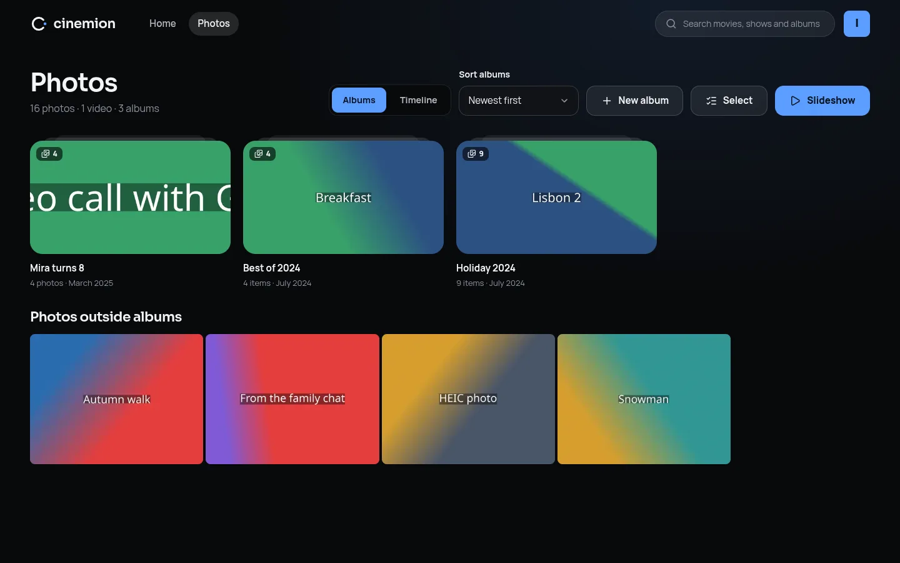
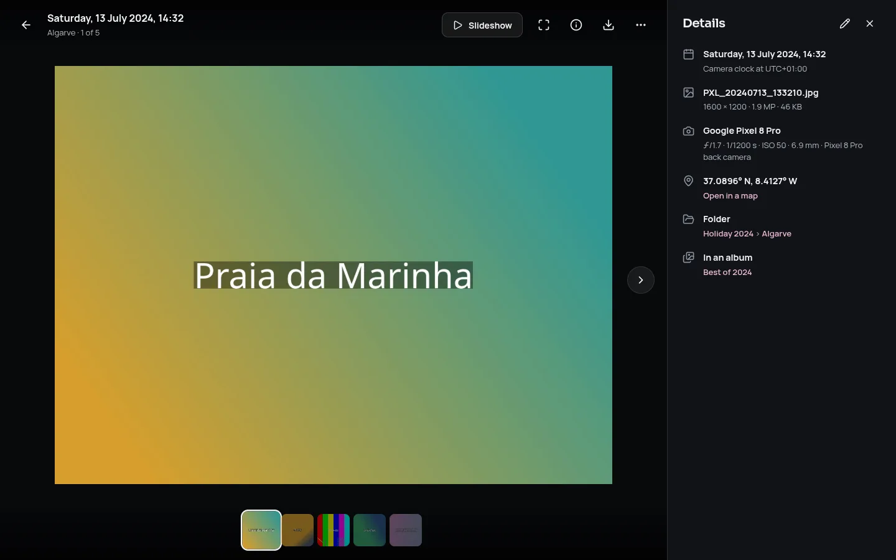
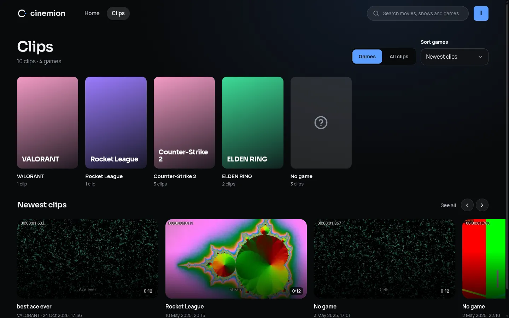

# Cinemion

Your movies, shows, music, books and photos, beautifully served from your own machine: a self-hosted media server that feels at home on the couch, at a desk and on a phone.

[](https://github.com/LucasionGS/cinemion/actions/workflows/ci.yml)
[](https://github.com/LucasionGS/cinemion/releases)

## Key Features

- **Looks like a cinema, not a file browser**: a dark, artwork-first interface that takes its colours from whatever you're about to watch. Prefer daylight? There's a light theme too (videos still play on a dark screen, we're not monsters).
- **Desktop, mobile and TV layouts**: one app that adapts to the screen. The TV layout is made for the couch, with big type and full remote, keyboard and game controller navigation.
- **Who's watching?**: a profile for everyone in the household, with optional PINs, age limits and profile pictures (upload a photo, crop it, done).
- **Set up in a minute**: a first-run wizard creates your account, points Cinemion at your movie and show folders, and picks where posters and plots come from.
- **Knows what your files are**: tidy folders, messy release names, multi-episode files and specials are all recognised. New and removed files are noticed by themselves.
- **Music, with a mini-player that keeps going**: albums, artists and songs sorted by their tags, covers from the files or a `cover.jpg`, a player that keeps playing while you browse (and on your lock screen), playlists for every profile, and lyrics that follow along when there's an LRC file. FLAC, ALAC and friends play everywhere: whatever a browser can't play is converted once.
- **Audiobooks and books**: audiobooks keep everyone's place, with chapters, playback speed and a sleep timer for when you nod off. EPUB books open in a built-in reader with light, sepia and dark pages; PDFs open right in the browser.
- **Home videos too**: a Videos library takes anything that isn't a movie or show (holidays, drone footage, recordings) without looking anything up. Folders become groups, titles come from the file names and dates from the recording, thumbnails are picked from the video itself, and you can edit it all by hand.
- **Photo albums**: point a Photos library at your pictures and every folder becomes an album, with dates, cameras and places read from the photos themselves (iPhone HEICs included) and phone videos mixed right in. Browse albums or one long timeline, flip through them full screen with a filmstrip and a details panel, or lean back with a slideshow. Make your own albums from photos anywhere in the library without moving a single file.
- **Game clips, sorted by game**: point a Clips library at your recordings and every clip lands under its game, read from the names NVIDIA's overlay, AMD's software, Xbox Game Bar, PlayStation, Steam and friends give their files, with covers from Steam. OBS recordings with nothing but a date in the name? Download picture recognition and Cinemion suggests the game from what's on screen, mostly by comparing with clips you've already sorted. Star the good ones, cut them down without losing quality, and make a copy small enough for Discord in two clicks.
- **Posters, plots and cast**: from NFO files and artwork next to your videos, from TMDB (no key needed, Cinemion brings its own) and TheTVDB, in the order you choose, with IMDb, Rotten Tomatoes and Metacritic scores when you add an OMDb key. Wrong match? Fix it in two clicks.
- **Trakt, per profile**: everyone can link their own Trakt account. What they watch is scrobbled as it plays, marking things watched lands in their Trakt history, and their Trakt history can come in the other way too.
- **My list**: bookmark anything you want to watch later and it waits for you in a row on the home screen. With Trakt linked, your list and your Trakt watchlist stay in step both ways, and things you added on Trakt that aren't here yet wait on the list until they arrive.
- **Plays (almost) anything, anywhere**: files your device can play go straight through untouched. Anything else is repackaged or converted on the fly, on the CPU or an Intel, AMD or NVIDIA GPU, with HDR turned into SDR for screens that need it. Pick audio tracks, subtitles and quality while you watch, or let Automatic quality follow your connection.
- **A player for every screen**: keyboard shortcuts on the desktop, big touch controls on phones, and remote-friendly scrubbing on the TV. The next episode lines itself up while the credits roll.
- **Skip the intro**: Cinemion compares the episodes of a season to find their opening and closing music (or reads the chapters), shows a "Skip intro" button, and starts the next episode while the credits roll. It can skip intros by itself, too.
- **Subtitles your way**: pick the size, colour and background of subtitles for your profile. Styled anime subtitles keep their own fonts, colours and signs.
- **Sound for your speakers**: tell each device whether it plays stereo, surround or goes through a receiver, and Cinemion converts (or doesn't) to match.
- **See where you're seeking**: thumbnails above the seek bar, and a filmstrip on the TV, so you land on the right scene.
- **Subtitles, sorted**: subtitle files next to your videos just show up, anything missing is a search away (OpenSubtitles, SubDL and Podnapisi) without leaving the player, and new movies and episodes can get subtitles in your languages all by themselves.
- **Take it with you**: save a movie or episode on your phone or laptop (the original, or a smaller copy the server makes) and watch it without a connection. Cinemion even opens offline, and what you watched catches up with the server once you're back. Needs Cinemion opened over https.
- **Watch together**: start a session, share a code, and everyone's play, pause and seek stay in step, each on their own screen. Chat along and send reactions that float across everyone's video. Only the host's progress is saved, so nobody's "continue watching" gets spoiled.
- **Picks up where you left off**: continue watching, next up, recently added and "because you watched", per profile. Collections, cast pages and search across titles, episodes and people.
- **Safe for kids**: give a profile an age limit and anything rated above it (or not rated at all) simply isn't there. Family videos can get a library-wide rating so the kids see them too.
- **A dashboard for the server**: who's watching what and on which device, whether it plays directly or is being converted (and why), CPU, GPU and disk use, running tasks, and a feed of what happened lately. "Mira finished Paper Moons" included.
- **Upload from the browser**: drop movies, episodes, music or books (or whole folders, or a zip file with a season in it) on a library in Settings, pick the folder they go in, and Cinemion puts them in place and scans them. Big files go up in pieces, so a dropped connection, a closed tab or a server restart doesn't mean starting over.
- **Uploads straight from Podium**: Cinemion speaks Podium's upload protocol, so clips go from the recorder into any library you pick, with their game, title, recording time and sound track names along for the ride. Same clip twice? Cinemion notices.
- **Sonarr and Radarr, connected**: paste one address into Sonarr or Radarr, and new downloads show up within seconds instead of at the next scan. Their folders look different in their container? A path mapping sorts that out.
- **Seerr and Homepage, welcome too**: request apps and dashboards made for other media servers can use Cinemion instead. Seerr signs in with your Cinemion login, knows what you already have and links straight back to it; Homepage shows what's playing and how big your libraries are. Keys for them are in Settings › Integrations.
- **Webhooks for everything else**: tell Home Assistant, a chat bot or your own script when playback starts, pauses or stops, a new episode arrives or someone signs in. Every message is signed, failed ones are retried, and there's a test button.
- **Tasks and logs at hand**: start scans and thumbnail jobs, choose how often libraries are scanned, and read the server log with filters, all in Settings. No terminal needed when something acts up.
- **Backups you'll actually have**: one click (or a nightly schedule) saves profiles, everyone's watch history, settings, playlists, albums and artwork into one file, optionally locked with a password. Cinemion makes one by itself before every update that changes its database, and a fresh install can be brought back from a backup right in the setup wizard.
- **Knows when there's a new version**: twice a day Cinemion looks at its releases on GitHub, and when there's a newer one, admins (and only admins) get a dot on their profile picture and a note on how to update. Rather it didn't? It's one switch in Settings › About, or `UPDATE_CHECK=false`.
- **Speaks your language (soon)**: every line of the interface lives in one translation file, so adding a language is filling in a copy of the English one. English is the only one so far; [here's how to add yours](docs/translating.md).
- **https built in**: switch on a secure address in Settings, with a certificate Cinemion makes itself (trust it once per device), a free one from Let's Encrypt for your own domain, or one you already have. No reverse proxy needed, and offline downloads work on your home network.
- **One container, nothing else**: the Docker image includes everything. No database server, no extra services. There's also a single-file binary if you'd rather skip Docker.
- **Plays nice with MediaHub**: open it in MediaHub and it starts straight in the TV layout, controller included.

## Screenshots


<sup>The home screen picks up where everyone left off, and takes its colours from whatever is selected.</sup>


<sup>Movie pages put the poster next to the details, with versions, audio and subtitles to pick from.</sup>


<sup>Shows have their episodes under season tabs, with what's watched and what's half done.</sup>


<sup>The player: seek thumbnails, tracks and quality in a side panel, and watch together one click away.</sup>


<sup>Videos libraries for everything else, with folders as groups and thumbnails from the videos themselves.</sup>


<sup>Photos libraries: folders become albums, and you can make your own.</sup>


<sup>The photo viewer, with a filmstrip and what the camera wrote down.</sup>


<sup>Clips libraries sort recordings into games by their names, with "No game" for the rest (and a guess, if you let it look).</sup>


<sup>The dashboard: who's watching what, whether it's converted (and why), and how busy the server is.</sup>

<p>
  
  
</p>
<sup>The same app on a phone and on a TV.</sup>

## Running it

Cinemion runs on Linux (x64 and arm64). Pick whichever way of installing suits you; they all end up at `http://<your-server>:8600`, where a short setup creates your account and libraries.

### Docker

```sh
docker run -d --name cinemion \
  -p 8600:8600 -p 8443:8443 \
  -v /path/to/config:/config \
  -v /path/to/movies:/media/movies:ro \
  -v /path/to/shows:/media/shows:ro \
  ghcr.io/lucasiongs/cinemion
```

Add `--device /dev/dri:/dev/dri` to let an Intel or AMD GPU help with video conversion, then pick it under Settings › Playback (there's a test button to check it works). `PUID` and `PGID` set which user owns the files in `/config` (default 1000).

Or with Docker Compose:

```yaml
services:
  cinemion:
    image: ghcr.io/lucasiongs/cinemion
    restart: unless-stopped
    ports:
      - "8600:8600"
      - "8443:8443" # built-in https, when it's turned on
    environment:
      PUID: "1000"
      PGID: "1000"
      TZ: "Europe/Amsterdam"
    volumes:
      - ./config:/config
      - ./cache:/cache
      - /path/to/media:/media:ro
    # devices:
    #   - /dev/dri:/dev/dri
```

### Arch Linux (AUR)

```sh
yay -S cinemion-bin
sudo systemctl enable --now cinemion
```

The service runs as the `cinemion` user, keeps its data in `/var/lib/cinemion`, and reads its settings from `/etc/cinemion/cinemion.env` (which folders the library browser may show, the port, API keys). The `cinemion` user has to be able to read your media folders.

### Single binary

Download `cinemion-<version>-linux_x64.tar.gz` (or `linux_arm64`) from the [releases](https://github.com/LucasionGS/cinemion/releases), unpack it, make sure `ffmpeg` is installed (`sudo pacman -S ffmpeg` or `sudo apt install ffmpeg`), and run `./cinemion`. For GPU conversion, also install your GPU's VA-API driver (`intel-media-driver` / `intel-media-va-driver-non-free` for Intel, `libva-mesa-driver` / `mesa-va-drivers` for AMD). Settings and the database go to `~/.cinemion`, and the folder browser starts in your home folder. See `.env.example` for everything you can change.

### Uploading from the browser

Settings › Libraries › ⋮ › Upload files puts files straight into a library folder. Cinemion needs write access to that folder for this; the examples above mount media read-only (`:ro`), which is safer, so drop the `:ro` from the folders you want to upload into. With the AUR package, allow the folder with `sudo systemctl edit cinemion`:

```ini
[Service]
ReadWritePaths=/srv/media/movies /srv/media/shows
```

Uploads wait in `<CACHE_DIR>/uploads` (`/cache/uploads` in Docker) until they're complete. Point `UPLOAD_DIR` at a folder on the same drive as your media and finished uploads move into place instantly instead of being copied. `UPLOAD_MAX_GB` caps the size of a single file. Behind a reverse proxy, allow request bodies of at least 64 MB (`client_max_body_size 64m;` in nginx) for the fastest uploads; smaller limits still work, just in smaller pieces.

### Uploading from Podium

Settings › Integrations › Podium makes an upload target for a library (and a folder in it, like `Podium`). In Podium, add a Podium-compatible server with the server URL shown there (`https://<your-server>/api/podium`) and the target's token. Uploads go up in 8 MB pieces, so a reverse proxy needs to allow request bodies of at least 9 MB (`client_max_body_size 16m;` in nginx). Cinemion needs write access to the library's folder, as for uploads from the browser.

### HTTPS

Settings › HTTPS turns on a second, encrypted address (port 8443, or `HTTPS_PORT`) next to the plain http one, so offline downloads work without a reverse proxy. The certificate comes from one of three places:

- **Made by Cinemion**: works on any home network. Cinemion runs its own little certificate authority; download its certificate from the settings page (or `http://<your-server>:8600/api/https/cinemion-ca.crt` on a phone) and trust it once per device. The page has the steps for Windows, Mac, iPhone, Android, Linux and Firefox. In Docker, add the address you open Cinemion at under "Extra names", since the container can't see it.
- **Let's Encrypt**: for a domain of your own. Point it at your home, forward port 80 to Cinemion's http port (Let's Encrypt checks the domain through it) and port 443 to the https port. Renewals happen by themselves.
- **Your own**: paste a certificate and key you already have.

"Send browsers to https" moves people who open the http address over; the API stays on http for Sonarr, Radarr, Seerr and webhooks. Behind a reverse proxy that already does https, leave all of this off.

### Backups

Settings › Backups makes backups by hand or on a schedule (every night or once a week, keeping the last few), into `<CONFIG_DIR>/backups` (`/config/backups` in Docker) unless you pick another folder there or set `BACKUP_DIR`. Put them on another drive (in Docker, mount one: `-v /mnt/backup/cinemion:/backups` plus `BACKUP_DIR=/backups`) so they survive the disk they're backing up. A backup is a plain `.tar.gz`; with a password it's encrypted and ends in `.enc`. Before an update that changes the database, Cinemion makes a backup by itself.

To restore one:

- **On a new install**: pick "Restore a backup" on the first page of the setup wizard. It lists backups in the backup folder, or you can upload one.
- **On an existing install**: stop Cinemion, then run `cinemion restore <file>` as the user it runs as (`sudo -u cinemion cinemion restore …`). With Docker, stop the container and run `docker compose run --rm cinemion cinemion restore /config/backups/<file>`.

Backups work across databases too: one made on SQLite restores on MariaDB and the other way around.

### Locked out?

The `cinemion` binary also has a few maintenance commands. Run `cinemion help` for all of them.

```sh
cinemion users                       # list everyone
cinemion reset-password ion          # set a new password
cinemion remove-pin mira             # take a profile's PIN off
cinemion backup                      # make a backup now
cinemion restore <file>              # put a backup back (stop the server first)
```

Run them as the user the server runs as, so they use the same data: `sudo -u cinemion cinemion users` for the AUR package, or `docker exec -u 1000 cinemion cinemion users` in Docker.

## Development

You need [Deno](https://deno.com) 2.9+ and ffmpeg.

```sh
cp .env.example .env    # APP_ENV=development makes the server proxy Vite
deno install
deno task dev:client    # Vite dev server (port 5173)
deno task dev           # API + app on http://localhost:8600
```

Other tasks:

| Task | What it does |
|---|---|
| `deno task build` | Build the web client into `client/dist` |
| `deno task start` | Run the server in production mode, serving `client/dist` |
| `deno task compile` | Build a single `cinemion` binary into `dist/<platform>/bin` |
| `deno task migrate` | Apply database migrations (`migrate down` reverts the last one) |
| `deno task cli help` | Maintenance commands, like resetting a password (the same as `cinemion help`) |
| `deno task check` / `lint` | Type-check and lint |

`docker compose up --build` builds and runs the image with everything kept in `./data`.

### Releasing

`./set_version.sh 1.2.0` sets the version everywhere (the server, the `deno.json` files and the AUR package). Commit it as "Bumped to 1.2.0", then tag and push: `git tag v1.2.0 && git push origin v1.2.0`. The Release workflow checks the code, builds the x64 and arm64 binaries onto a GitHub release, and pushes the Docker image (amd64 and arm64) to `ghcr.io/lucasiongs/cinemion`. Once it's done, `scripts/aur-publish.sh` updates the `cinemion-bin` AUR package.

`scripts/make-sample-media.sh` fills `data/media` with a small fake library (short ffmpeg clips with tidy and messy names, NFO files, artwork, extras and samples, and game clips named the way recorders name them) for trying things out. Online matching through TMDB works out of the box with the built-in key.

`deno run -A server/src/test.ts` runs the scratch checks: file names, playback decisions, Sonarr/Radarr payloads, webhook signatures and more.

Every line of the interface is in `client/src/i18n/locales/en.json`; use `t("some.key")` from `client/src/i18n/I18n.ts` instead of writing English in components. `deno task i18n` checks that every language matches English and lists lines nothing uses any more. Adding a language is in [docs/translating.md](docs/translating.md).

### Layout

```
shared/   Types shared by the server and the client
server/   Deno + Hono API, Sequelize models and Umzug migrations (SQLite by default, MariaDB optional)
client/   React + Vite + SCSS web app with Cinemion's own design system
docs/     Design decisions and future plans
```

## Credits


This product uses TMDB and the TMDB APIs but is not endorsed, certified, or otherwise approved by TMDB.

Game names and artwork come from the Steam store and, with your own key, [SteamGridDB](https://www.steamgriddb.com). Picture recognition uses OpenAI's [CLIP](https://github.com/openai/CLIP) model (the ONNX conversion by [Xenova](https://huggingface.co/Xenova/clip-vit-base-patch16)), run by [ONNX Runtime](https://onnxruntime.ai); both are downloaded only when you ask for them.

## License

GPL-3.0-or-later. See [LICENSE](LICENSE).
