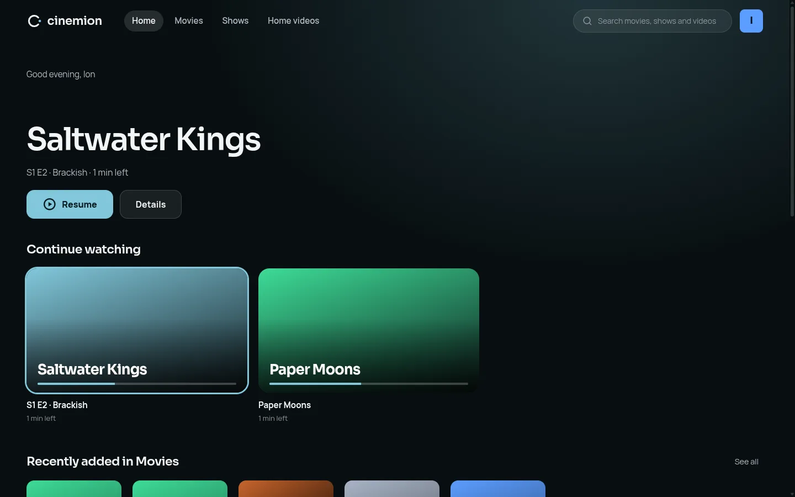
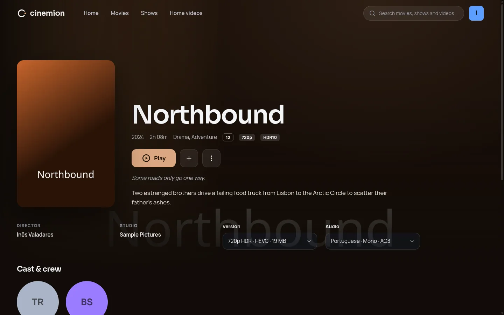
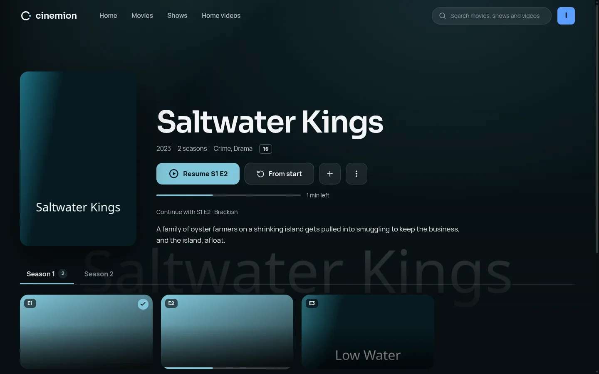
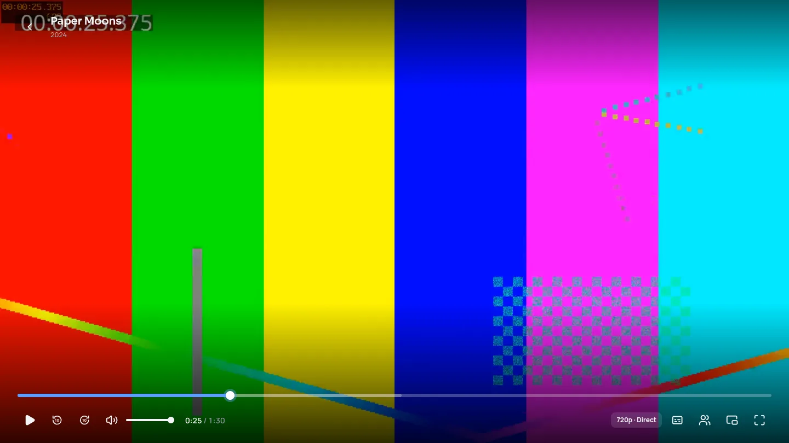
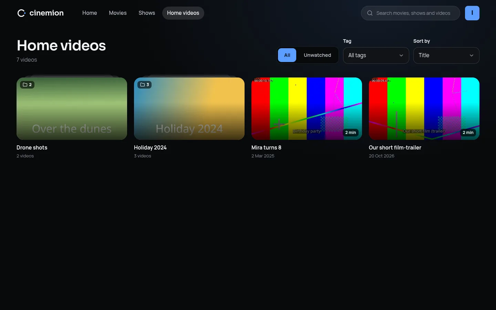
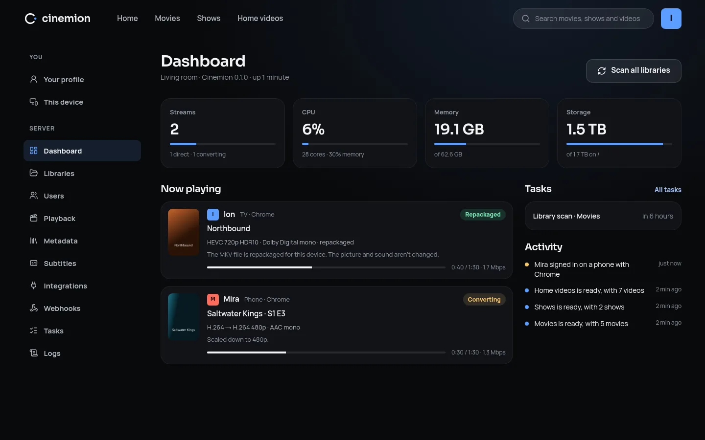
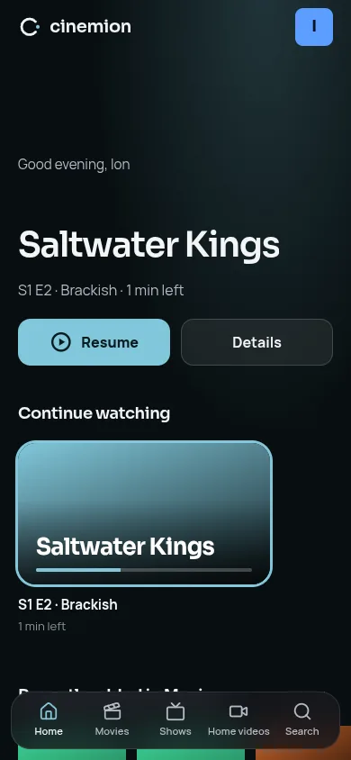
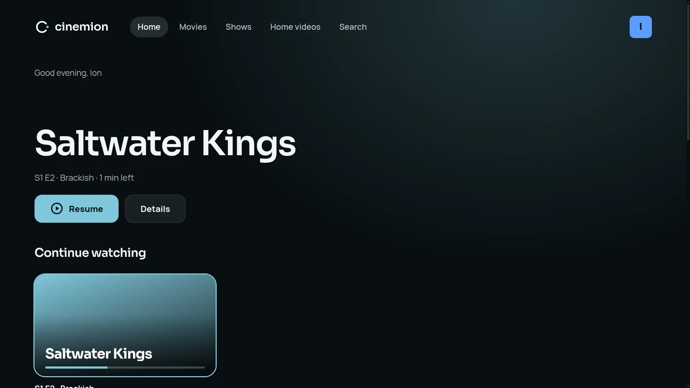

# Cinemion

Your movies and shows, beautifully served from your own machine: a self-hosted media server that feels at home on the couch, at a desk and on a phone.

[](https://github.com/LucasionGS/cinemion/actions/workflows/ci.yml)
[](https://github.com/LucasionGS/cinemion/releases)

## Key Features

- **Looks like a cinema, not a file browser**: a dark, artwork-first interface that takes its colours from whatever you're about to watch.
- **Desktop, mobile and TV layouts**: one app that adapts to the screen. The TV layout is made for the couch, with big type and full remote, keyboard and game controller navigation.
- **Who's watching?**: a profile for everyone in the household, with optional PINs, age limits and profile pictures (upload a photo, crop it, done).
- **Set up in a minute**: a first-run wizard creates your account, points Cinemion at your movie and show folders, and picks where posters and plots come from.
- **Knows what your files are**: tidy folders, messy release names, multi-episode files and specials are all recognised. New and removed files are noticed by themselves.
- **Home videos too**: a Videos library takes anything that isn't a movie or show (holidays, drone footage, recordings) without looking anything up. Folders become groups, titles come from the file names and dates from the recording, thumbnails are picked from the video itself, and you can edit it all by hand.
- **Posters, plots and cast**: from NFO files and artwork next to your videos, from TMDB, or both, in the order you choose. Wrong match? Fix it in two clicks.
- **Plays (almost) anything, anywhere**: files your device can play go straight through untouched. Anything else is repackaged or converted on the fly, on the CPU or an Intel, AMD or NVIDIA GPU, with HDR turned into SDR for screens that need it. Pick audio tracks, subtitles and quality while you watch.
- **A player for every screen**: keyboard shortcuts on the desktop, big touch controls on phones, and remote-friendly scrubbing on the TV. The next episode lines itself up while the credits roll.
- **Skip the intro**: Cinemion compares the episodes of a season to find their opening and closing music (or reads the chapters), shows a "Skip intro" button, and starts the next episode while the credits roll. It can skip intros by itself, too.
- **Subtitles your way**: pick the size, colour and background of subtitles for your profile. Styled anime subtitles keep their own fonts, colours and signs.
- **Sound for your speakers**: tell each device whether it plays stereo, surround or goes through a receiver, and Cinemion converts (or doesn't) to match.
- **See where you're seeking**: thumbnails above the seek bar, and a filmstrip on the TV, so you land on the right scene.
- **Subtitles, sorted**: subtitle files next to your videos just show up, and anything missing is a search away (OpenSubtitles) without leaving the player.
- **Watch together**: start a session, share a code, and everyone's play, pause and seek stay in step, each on their own screen. Only the host's progress is saved, so nobody's "continue watching" gets spoiled.
- **Picks up where you left off**: continue watching, next up, recently added and "because you watched", per profile. Collections, cast pages and search across titles, episodes and people.
- **Safe for kids**: give a profile an age limit and anything rated above it (or not rated at all) simply isn't there. Family videos can get a library-wide rating so the kids see them too.
- **A dashboard for the server**: who's watching what and on which device, whether it plays directly or is being converted (and why), CPU, GPU and disk use, running tasks, and a feed of what happened lately. "Mira finished Paper Moons" included.
- **Sonarr and Radarr, connected**: paste one address into Sonarr or Radarr, and new downloads show up within seconds instead of at the next scan. Their folders look different in their container? A path mapping sorts that out.
- **Webhooks for everything else**: tell Home Assistant, a chat bot or your own script when playback starts, pauses or stops, a new episode arrives or someone signs in. Every message is signed, failed ones are retried, and there's a test button.
- **Tasks and logs at hand**: start scans and thumbnail jobs, choose how often libraries are scanned, and read the server log with filters, all in Settings. No terminal needed when something acts up.
- **One container, nothing else**: the Docker image includes everything. No database server, no extra services. There's also a single-file binary if you'd rather skip Docker.
- **Plays nice with MediaHub**: open it in MediaHub and it starts straight in the TV layout, controller included.

## Screenshots


<sup>The home screen picks up where everyone left off, and takes its colours from whatever is selected.</sup>


<sup>Movie pages put the poster next to the details, with versions, audio and subtitles to pick from.</sup>


<sup>Shows have their episodes under season tabs, with what's watched and what's half done.</sup>


<sup>The player: seek thumbnails, tracks and quality in a side panel, and watch together one click away.</sup>


<sup>Videos libraries for everything else, with folders as groups and thumbnails from the videos themselves.</sup>


<sup>The dashboard: who's watching what, whether it's converted (and why), and how busy the server is.</sup>

<p>
  
  
</p>
<sup>The same app on a phone and on a TV.</sup>

## Running it

Cinemion runs on Linux (x64 and arm64). Pick whichever way of installing suits you; they all end up at `http://<your-server>:8600`, where a short setup creates your account and libraries.

### Docker

```sh
docker run -d --name cinemion \
  -p 8600:8600 \
  -v /path/to/config:/config \
  -v /path/to/movies:/media/movies:ro \
  -v /path/to/shows:/media/shows:ro \
  ghcr.io/lucasiongs/cinemion
```

Add `--device /dev/dri:/dev/dri` to let an Intel or AMD GPU help with video conversion, then pick it under Settings › Playback (there's a test button to check it works). `PUID` and `PGID` set which user owns the files in `/config` (default 1000).

Or with Docker Compose:

```yaml
services:
  cinemion:
    image: ghcr.io/lucasiongs/cinemion
    restart: unless-stopped
    ports:
      - "8600:8600"
    environment:
      PUID: "1000"
      PGID: "1000"
      TZ: "Europe/Amsterdam"
    volumes:
      - ./config:/config
      - ./cache:/cache
      - /path/to/media:/media:ro
    # devices:
    #   - /dev/dri:/dev/dri
```

### Arch Linux (AUR)

```sh
yay -S cinemion-bin
sudo systemctl enable --now cinemion
```

The service runs as the `cinemion` user, keeps its data in `/var/lib/cinemion`, and reads its settings from `/etc/cinemion/cinemion.env` (which folders the library browser may show, the port, API keys). The `cinemion` user has to be able to read your media folders.

### Single binary

Download `cinemion-<version>-linux_x64.tar.gz` (or `linux_arm64`) from the [releases](https://github.com/LucasionGS/cinemion/releases), unpack it, make sure `ffmpeg` is installed (`sudo pacman -S ffmpeg` or `sudo apt install ffmpeg`), and run `./cinemion`. For GPU conversion, also install your GPU's VA-API driver (`intel-media-driver` / `intel-media-va-driver-non-free` for Intel, `libva-mesa-driver` / `mesa-va-drivers` for AMD). Settings and the database go to `~/.cinemion`, and the folder browser starts in your home folder. See `.env.example` for everything you can change.

### Locked out?

The `cinemion` binary also has a few maintenance commands. Run `cinemion help` for all of them.

```sh
cinemion users                       # list everyone
cinemion reset-password ion          # set a new password
cinemion remove-pin mira             # take a profile's PIN off
```

Run them as the user the server runs as, so they use the same data: `sudo -u cinemion cinemion users` for the AUR package, or `docker exec -u 1000 cinemion cinemion users` in Docker.

## Development

You need [Deno](https://deno.com) 2.9+ and ffmpeg.

```sh
cp .env.example .env    # APP_ENV=development makes the server proxy Vite
deno install
deno task dev:client    # Vite dev server (port 5173)
deno task dev           # API + app on http://localhost:8600
```

Other tasks:

| Task | What it does |
|---|---|
| `deno task build` | Build the web client into `client/dist` |
| `deno task start` | Run the server in production mode, serving `client/dist` |
| `deno task compile` | Build a single `cinemion` binary into `dist/<platform>/bin` |
| `deno task migrate` | Apply database migrations (`migrate down` reverts the last one) |
| `deno task cli help` | Maintenance commands, like resetting a password (the same as `cinemion help`) |
| `deno task check` / `lint` | Type-check and lint |

`docker compose up --build` builds and runs the image with everything kept in `./data`.

### Releasing

`./set_version.sh 1.2.0` sets the version everywhere (the server, the `deno.json` files and the AUR package). Commit it as "Bumped to 1.2.0", then tag and push: `git tag v1.2.0 && git push origin v1.2.0`. The Release workflow checks the code, builds the x64 and arm64 binaries onto a GitHub release, and pushes the Docker image (amd64 and arm64) to `ghcr.io/lucasiongs/cinemion`. Once it's done, `scripts/aur-publish.sh` updates the `cinemion-bin` AUR package.

`scripts/make-sample-media.sh` fills `data/media` with a small fake library (short ffmpeg clips with tidy and messy names, NFO files, artwork, extras and samples) for trying things out. Add a TMDB API key in Settings › Metadata to see online matching.

`deno run -A server/src/test.ts` runs the scratch checks: file names, playback decisions, Sonarr/Radarr payloads, webhook signatures and more.

### Layout

```
shared/   Types shared by the server and the client
server/   Deno + Hono API, Sequelize models and Umzug migrations (SQLite by default, MariaDB optional)
client/   React + Vite + SCSS web app with Cinemion's own design system
docs/     Design decisions and future plans
```

## License

GPL-3.0-or-later. See [LICENSE](LICENSE).
